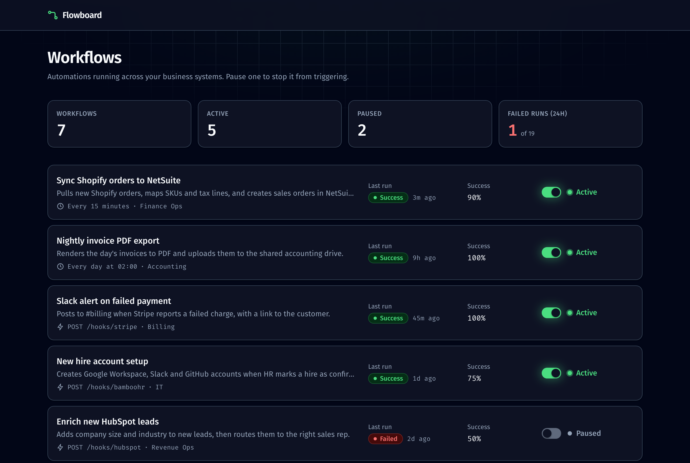
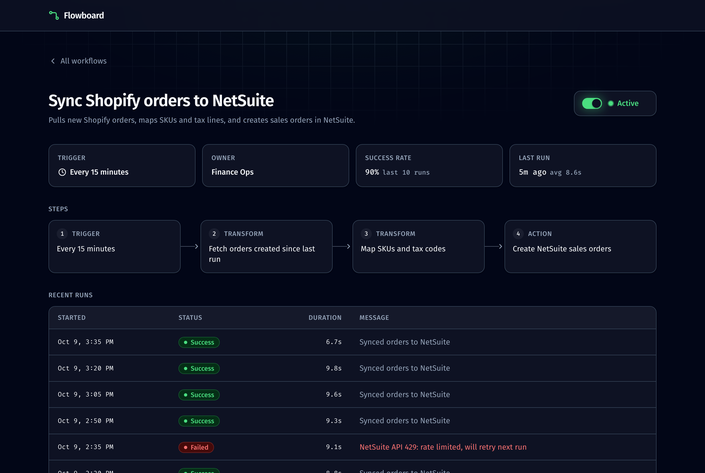

# Flowboard

A small dashboard for business automation workflows, e.g. "Sync Shopify orders to NetSuite" or "Slack alert on failed payment". You can see each workflow's trigger, recent runs and success rate, and pause or resume it.

Built with Next.js 15 (App Router), React 19, TypeScript and Tailwind CSS v4.





## Running it

Requires Node.js 18.18 or newer.

```bash
npm install
npm run dev
```

Open http://localhost:3000.

Production build:

```bash
npm run build
npm start
```

Checks: `npm run lint` and `npx tsc --noEmit`.

## What's where

| Path                                    | Purpose                                            |
| --------------------------------------- | -------------------------------------------------- |
| `src/app/page.tsx`                      | Workflow list, rendered on the server              |
| `src/app/workflows/[id]/page.tsx`       | Dynamic detail route                               |
| `src/app/actions.ts`                    | Server action                                      |
| `src/components/StatusToggle.tsx`       | The only client component: the pause/resume switch |
| `src/lib/data.ts`                       | Seed data and the in-memory store                  |
| `src/lib/types.ts`, `src/lib/format.ts` | Domain types and formatting helpers                |

## Server action

`updateWorkflowStatus(id, status)` in `src/app/actions.ts` pauses or resumes a workflow.

- The switch is a plain `<form action={...}>`, so it works before JavaScript loads.
- While the request is pending, the switch shows the target state and is disabled, so the click feels instant and can't be double-submitted.
- The action takes the _desired_ status, not "toggle". A repeated submit, or a second tab with stale state, can't flip the workflow back by accident.
- Server actions are public POST endpoints, so the action validates the id against the store and the status against the allowed values before changing anything.
- It then calls `revalidatePath` for the list and the detail page so both show the new state.

## Dynamic route

`/workflows/[id]` shows one workflow: trigger, owner, success rate, average duration, its steps as a pipeline, and a table of recent runs with error messages.

- `params` is awaited (it's a Promise in Next.js 15).
- Unknown ids call `notFound()` and render `not-found.tsx`.
- `generateMetadata` sets the page title to the workflow name.

## Assumptions and tradeoffs

- **Data is mock and in memory.** Workflows are seeded in `src/lib/data.ts`; run timestamps are relative to server start so the demo never looks stale. Pause/resume state lasts until the server restarts. A real version would put the store behind a database, and only `src/lib/data.ts` would need to change.
- **Single server process.** The store lives on `globalThis`, so it's shared across routes and survives dev hot reloads. On serverless hosting (e.g. Vercel), each instance has its own memory, so state would be inconsistent there. That's why this is meant to run locally.
- **Pausing doesn't stop real jobs.** There is no scheduler; "paused" is the state a scheduler would check before running.
- **Pages render per request** (`dynamic = "force-dynamic"`) because the data can change at any time.
- **"Failed runs (24h)"** counts runs across all workflows whose start time is within the last 24 hours.

## What I'd do next

- Move the data into Postgres with Prisma. Pages and the action only call functions in `src/lib/data.ts`, so that file is the only one that would change.
- Add a scheduler or job queue that checks a workflow's status before each run, so pausing actually stops work.
- Require sign-in before the action runs, and record who paused or resumed each workflow.
- Write unit tests for the action's input validation.
- Add a status filter on the list page using `searchParams`, so a filtered view has its own URL.

## AI usage

I used Claude Code. Its instruction file is [`AGENTS.md`](./AGENTS.md), committed as-is. It sets the stack constraints (Next 15, Tailwind v4, no new dependencies), the folder layout, the rules for server actions, and the checks to run before a task is done. For the visual design (palette, type, spacing, accessibility checks) I directed it to use a UI/UX design skill.

## Time spent

About 2 hours.
